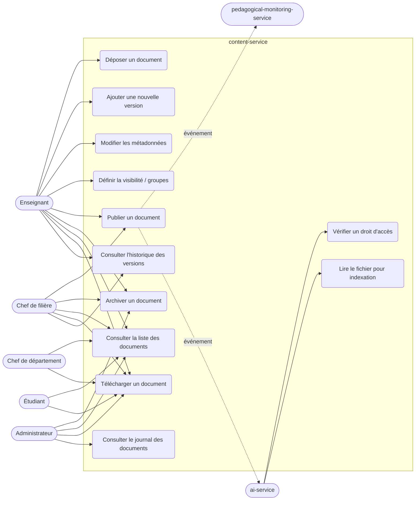
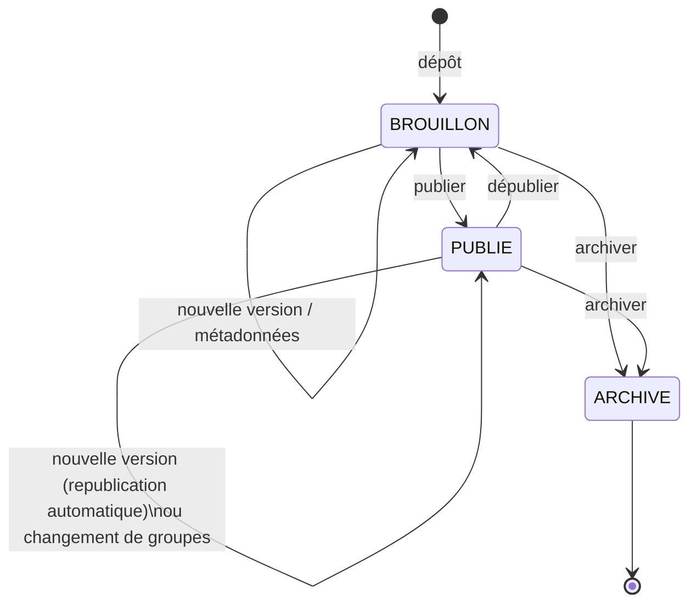
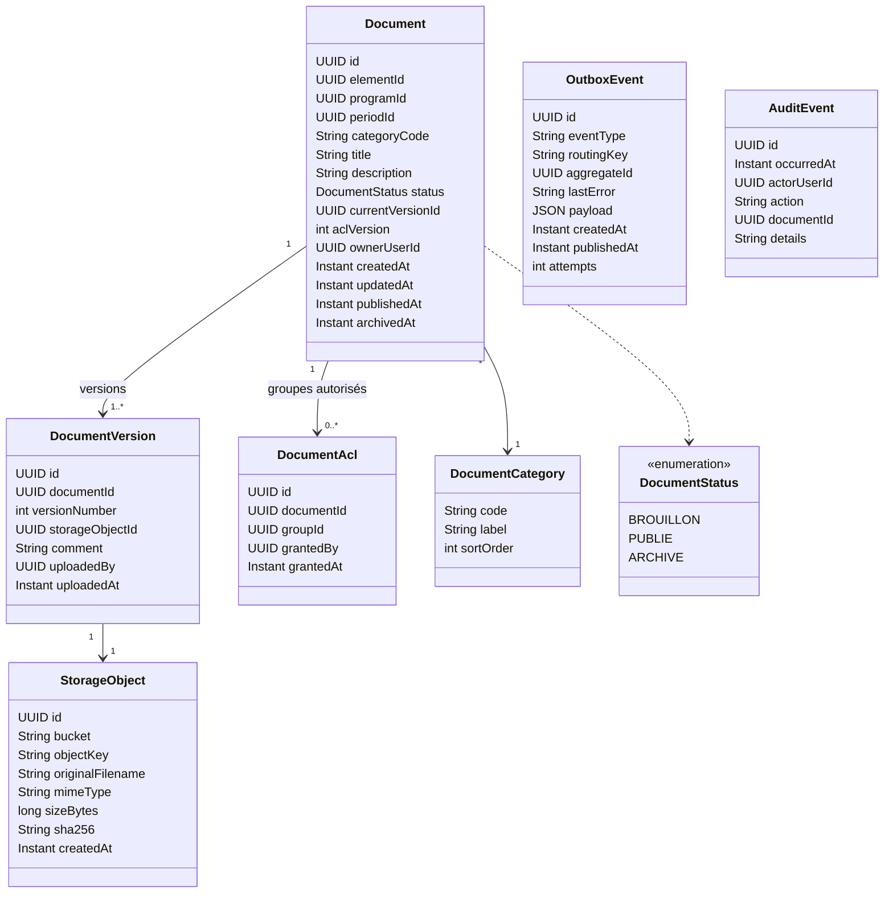
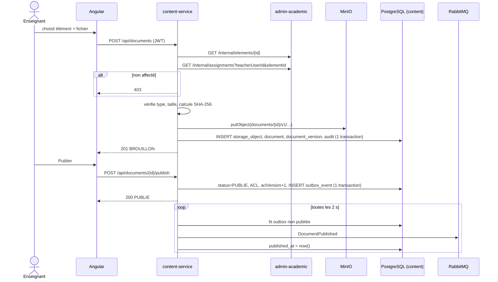
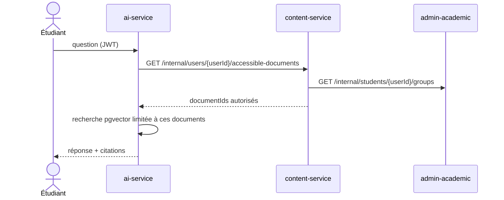

# content-service — Dossier de conception

Service n°4 d'ENSiaS. Responsable : **Ihssan (M4)**.
Statut : **v0.2** — décisions de la section 6 prises le 10/11/2026 (à présenter à l'encadrant).

| | |
|---|---|
| Rôle | Documents pédagogiques (cours, TD, TP, annales) : dépôt, classement, versions, droits d'accès (ACL), métadonnées, publication, stockage |
| Port | **8084** (proposé à l'équipe : 8081 admin-academic, 8082 planning, 8083 monitoring, 8085 ai) |
| Base | PostgreSQL, schéma **`content`**, utilisateur `content_user` |
| Fichiers | MinIO, bucket **`ensias-documents`** (privé, jamais exposé directement) |
| Événements | `DocumentPublished`, `DocumentAccessRevoked` (voir [EVENTS.md](EVENTS.md)) |
| Exigences couvertes | EF-10 (documents), EF-15 (audit des documents), ENF-01/02 (sécurité, confidentialité), flux G et « Document et assistant IA » |

---

## 1. Cas d'utilisation

---

## 2. Règles métier

### 2.1 Document
- Un document est **toujours rattaché à un élément** (`elementId`, UUID de l'administration-academic-service). Il hérite donc de la filière, du module et de la période de cet élément.
- Catégories : `COURS`, `TD`, `TP`, `ANNALE` (table de référence `document_category`, extensible).
- Un document a **une ou plusieurs versions**. Une seule est la **version courante** ; les anciennes restent téléchargeables par les gestionnaires (historique).
- Formats acceptés : **PDF** (seul format indexé par l'IA), **DOCX**, **PPTX**. Taille max **50 Mo**. Les ZIP sont refusés : contenu non vérifiable et non indexable.
- Le type réel du fichier est vérifié (signature du fichier, pas seulement l'extension) et une empreinte **SHA-256** est calculée.

### 2.2 Cycle de vie

| Transition | Qui | Événement émis |
|---|---|---|
| dépôt → BROUILLON | enseignant affecté | aucun |
| BROUILLON → PUBLIE | enseignant affecté, chef de filière | `DocumentPublished` |
| PUBLIE + nouvelle version | enseignant affecté | `DocumentPublished` (nouvelle `versionId`, l'IA réindexe) |
| PUBLIE + groupes retirés | enseignant affecté, chef de filière | `DocumentAccessRevoked` (groupes retirés) puis `DocumentPublished` si groupes ajoutés |
| PUBLIE → BROUILLON | enseignant affecté, chef de filière | `DocumentAccessRevoked` (reason `UNPUBLISHED`) |
| → ARCHIVE | auteur, chef de filière, admin | `DocumentAccessRevoked` (reason `ARCHIVED`) si était publié |

Pas de suppression physique depuis l'API : l'archivage remplace la suppression (traçabilité EF-15). Seul un BROUILLON jamais publié peut être supprimé définitivement par son auteur (erreur de dépôt).

### 2.3 Droits d'accès (RBAC + périmètre + ACL)

L'ACL d'un document = la liste des **groupes d'étudiants** qui peuvent le voir une fois publié (`document_acl`).
Par défaut à la publication : les groupes pour lesquels l'enseignant est affecté à l'élément.

| Action | ADMIN | CHEF_DEPARTEMENT | CHEF_FILIERE | ENSEIGNANT | ETUDIANT |
|---|---|---|---|---|---|
| Déposer / nouvelle version | – | – | – | ✅ s'il est **affecté à l'élément** | ❌ |
| Modifier métadonnées, groupes | – | – | ✅ sa filière | ✅ affecté à l'élément | ❌ |
| Publier / dépublier | – | – | ✅ sa filière | ✅ affecté à l'élément | ❌ |
| Archiver | ✅ | – | ✅ sa filière | ✅ auteur | ❌ |
| Voir brouillons + anciennes versions | ✅ | ✅ son département | ✅ sa filière | ✅ affecté à l'élément | ❌ |
| Voir / télécharger publié | ✅ | ✅ son département | ✅ sa filière | ✅ affecté à l'élément | ✅ si **un de ses groupes** est dans l'ACL, version courante uniquement |
| Journal des documents | ✅ | – | – | – | – |

Règles de sécurité :
- Toute décision est prise **côté backend** à chaque requête (le menu Angular n'est qu'un confort).
- Un document refusé renvoie **404** (et non 403) pour ne pas révéler son existence. Une action interdite sur un document visible (ex. un étudiant qui tente de publier) renvoie **403**.
- Le téléchargement passe **par le service** (flux renvoyé par content-service) ; MinIO n'est jamais accessible depuis le navigateur. (Alternative : URL présignée de 5 min — plus tard si besoin de performance.)
- Les appels vers l'administration-academic-service (`/internal/**`) se font avec `X-Internal-Key`.

### 2.4 Données venant d'autres services (aucune lecture de leurs tables)

| Besoin | Endpoint utilisé | Statut |
|---|---|---|
| Élément existe, sa filière, sa période | `GET /internal/elements/{id}` | ✅ existe |
| Enseignant affecté à élément + groupe | `GET /internal/assignments/check?elementId=&teacherUserId=&groupId=` | ✅ existe |
| Groupes d'un enseignant pour un élément | `GET /internal/assignments?periodId=&teacherUserId=&elementId=` | ✅ existe |
| Groupes d'un étudiant | `GET /internal/students/{userId}/groups` | ✅ existe |
| Filières dirigées par un chef / filières d'un département | `GET /internal/programs?headUserId=&departmentId=` (paramètres facultatifs) | ✅ ajouté par Aya le 10/11 |
| Départements dirigés par un chef | `GET /internal/departments?headUserId=` | ✅ ajouté par Aya le 10/11 |

---

## 3. Modèle de données (schéma `content`)

Choix :
- `programId` et `periodId` sont **copiés** depuis l'élément au dépôt : cela permet de filtrer « documents de ma filière / de la période » sans appeler l'autre service à chaque liste.
- `aclVersion` augmente à chaque changement de droits ; il est envoyé dans les événements pour que l'ai-service ignore un événement plus ancien que ce qu'il connaît (idempotence).
- `storage_object` est séparé de la version : un fichier envoyé dans MinIO mais dont la transaction échoue peut être retrouvé et nettoyé.
- Clé MinIO : `documents/{documentId}/v{versionNumber}/{uuid}.{ext}` (jamais le nom original, pour éviter les caractères dangereux).
- Contraintes : `UNIQUE(document_id, version_number)`, `UNIQUE(document_id, group_id)`, `UNIQUE(bucket, object_key)`, index sur `element_id`, `program_id`, `status`, `document_acl.group_id`, `outbox_event(published_at) WHERE published_at IS NULL`.
- Audit : table locale `audit_event`, même structure que chez Aya (EF-15 : qui / quand / quoi).

---

## 4. API

### 4.1 API publique (JWT obligatoire, préfixe `/api`)

| Méthode | Chemin | Rôle | Description |
|---|---|---|---|
| `POST` | `/api/documents` (multipart : `file` + `metadata` JSON) | ENSEIGNANT | Dépôt → BROUILLON, version 1 |
| `GET` | `/api/documents?elementId=&programId=&category=&status=&q=&page=&size=` | tous | Liste **filtrée selon les droits** |
| `GET` | `/api/documents/{id}` | tous (selon droits) | Détail + version courante |
| `PATCH` | `/api/documents/{id}` | ENSEIGNANT, CHEF_FILIERE | Titre, description, catégorie |
| `POST` | `/api/documents/{id}/versions` (multipart : `file`, `comment`) | ENSEIGNANT | Nouvelle version |
| `GET` | `/api/documents/{id}/versions` | gestionnaires | Historique des versions |
| `GET` | `/api/documents/{id}/download` | tous (selon droits) | Fichier de la version courante |
| `GET` | `/api/documents/{id}/versions/{n}/download` | gestionnaires | Ancienne version |
| `PUT` | `/api/documents/{id}/groups` (body `{ "groupIds": [...] }`) | ENSEIGNANT, CHEF_FILIERE | Remplace l'ACL |
| `POST` | `/api/documents/{id}/publish` | ENSEIGNANT, CHEF_FILIERE | BROUILLON → PUBLIE |
| `POST` | `/api/documents/{id}/unpublish` | ENSEIGNANT, CHEF_FILIERE | PUBLIE → BROUILLON |
| `POST` | `/api/documents/{id}/archive` | auteur, CHEF_FILIERE, ADMIN | → ARCHIVE |
| `GET` | `/api/document-categories` | tous | Liste des catégories |
| `GET` | `/api/documents/audit?documentId=` | ADMIN | Journal |

Erreurs au format RFC 9457 (`ProblemDetail`), comme l'administration-academic-service :
400 données invalides / fichier refusé, 401 sans token, 403 rôle insuffisant, 404 introuvable ou non autorisé, 409 transition d'état impossible, 413 fichier trop gros.

### 4.2 API interne (en-tête `X-Internal-Key`, jamais routée par la Gateway)

| Méthode | Chemin | Utilisé par | Réponse |
|---|---|---|---|
| `GET` | `/internal/documents/{id}/access?userId=` | ai-service | `{ "allowed": true, "aclVersion": 3 }` — vérifie les droits **actuels** |
| `GET` | `/internal/users/{userId}/accessible-documents` | ai-service | `{ "documentIds": [...] }` — pour filtrer la recherche pgvector **avant** la recherche (ENF-10) |
| `GET` | `/internal/documents/{id}` | ai-service, monitoring | métadonnées + version courante + groupes |
| `GET` | `/internal/documents/{id}/versions/{versionId}/content` | ai-service | flux du fichier (pour l'indexation) |

---

## 5. Séquences

### 5.1 Dépôt puis publication

### 5.2 Question d'un étudiant à l'IA

---

## 6. Décisions (prises le 10/11/2026)

| # | Sujet | Décision | Raison |
|---|---|---|---|
| 1 | Port | **8084** ; numérotation proposée à l'équipe : 8082 planning, 8083 monitoring, 8085 ai | Ordre des services dans le cahier des charges |
| 2 | Formats et taille | **PDF, DOCX, PPTX**, **50 Mo** max | PDF indispensable pour l'IA ; ZIP refusé (contenu invisible, risque de fichiers malveillants) |
| 3 | Document non autorisé | **404** si l'utilisateur ne peut pas le voir, **403** s'il le voit mais l'action est interdite | Ne pas révéler l'existence d'un document privé (critère EF-10) |
| 4 | Suppression | **Archivage** à la place de la suppression ; suppression définitive seulement d'un brouillon jamais publié, par son auteur | Traçabilité EF-15, et l'IA a pu indexer un document publié |
| 5 | Droits du chef de filière | Il peut **publier, dépublier, archiver** les documents de sa filière, mais pas déposer à la place d'un enseignant | Cahier des charges : le chef de filière « valide » et supervise |
| 6 | Périmètre des chefs | Chef de filière : `programs?headUserId=`. Chef de département : `departments?headUserId=` puis `programs?departmentId=<id>` (endpoints d'Aya, 10/11) | Aucune lecture de la base d'un autre service |
| 7 | RabbitMQ | Propriété de Soumia (M3). Le content-service écrit ses événements dans sa **table outbox** dès l'étape 4 ; l'envoi vers RabbitMQ est branché à l'étape 7 | Aucun blocage : rien n'est perdu en attendant |
